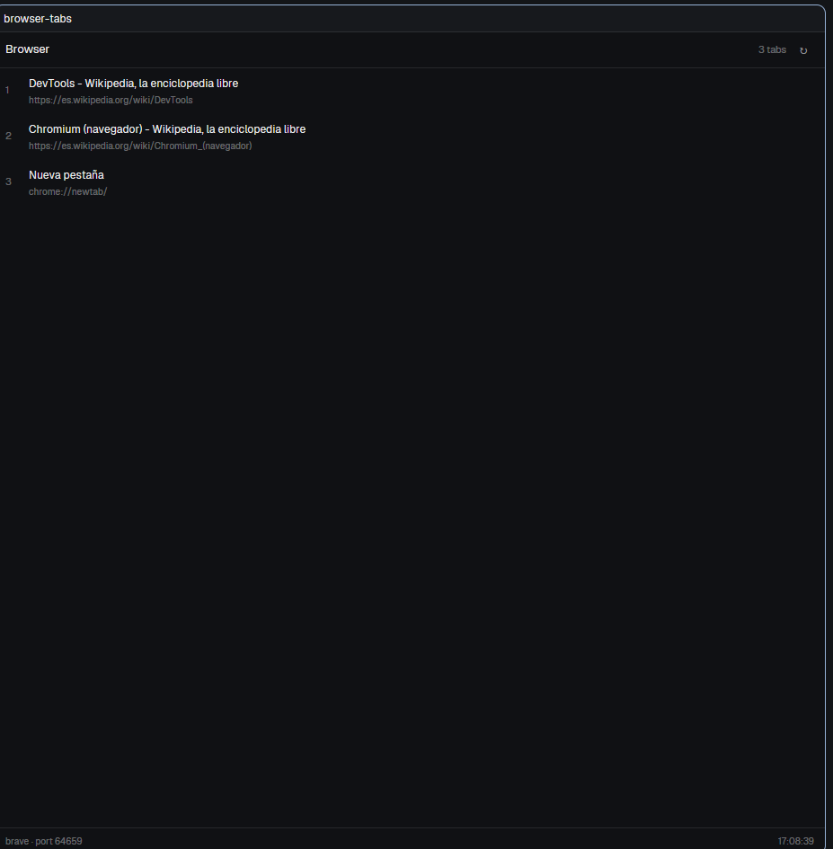

# Browser tabs

A panel that lists the tabs of the Chromium browser that
[herdr-browser](https://github.com/Abrahamism/herdr-browser) controls, and switches to one when
you click it. It is a read-only view plus one action: no credentials, no helper program, and no
network beyond `127.0.0.1`.

## What you see

- A full-height column, themed by `theme()`: background `chrome`, separators `border`.
- Herdr draws the pane header above it; the mod starts with its own header: 12px horizontal and
  8px vertical padding, "Browser" (12.5px, `foreground`), a right-aligned count ("3 tabs",
  10.5px, `dim`), and a `↻` button (12px, `muted`) that fills with `hover` on hover.
- One row per tab, 7px vertical and 12px horizontal padding, separated by a 1px `chrome` line:
  the 1-based index (10.5px, `dim`, 18px wide), then the title (12px, `foreground`, truncated)
  over the URL (10px, `dim`, truncated). Hovering a row paints `hover`.
- Footer, 6px vertical padding: `<browser> · port <port>` (10px, `dim`) on the left, and the last
  refresh time `HH:MM:SS` on the right.
- With the browser stopped: "Browser not running" (12px, `muted`), the hint
  "Start it with: herdr-browser open <url>" (10.5px, `dim`), and the fetch error when there is one.
- With no page targets: "No tabs".

## How it behaves

- Reads `browser-tabs.json` (next to `main.js`) for `profile` (default `default`) and `refreshMs`
  (default `3000`, minimum `1000`).
- Resolves the browser state file for that profile, reads its `port`, and calls
  `GET http://127.0.0.1:<port>/json/list`; only targets with `type == "page"` are listed, in the
  order Chrome returns them.
- Polls every `refreshMs` (3s by default). Timers keep running while the mod is hidden, so the
  interval is deliberately gentle.
- `↻` sends the `browser-tabs.refresh` command to the mod, which repaints immediately.
- Clicking a row calls `GET /json/activate/<id>`; that raises the tab in the browser window, and
  the next poll repaints the list.
- There are no agent statuses and no animations. The list uses `overflow_scroll()` and scrolls
  when it is taller than the pane.

## Built from

- `mods/browser-tabs/main.js`: a `View` from `gpui-kit`.
  - `init` seeds the state, calls `refresh(cx)`, registers `cx.timer.every(3000, ...)`, and loops
    on `nextCommand()`, handling only `"refresh"`.
  - `refresh(cx)` spawns an async task: `readConfig()` -> `readBrowser(profile)` ->
    `fetch(/json/list)` -> maps to `{id, index, title, url}` -> `cx.notify()`.
  - `activate(id)` fetches `/json/activate/<id>`.
  - `render()` builds `h_flex`/`v_flex` rows from `theme()`.
- `mods/browser-tabs/mod.json`: `{"place":"none","size":300,"title":"Browser tabs"}`. It does not
  dock itself; add it with a pane or a tab.
- `mods/browser-tabs/browser-tabs.json`: `{"profile":"default","refreshMs":3000}`.
- Herdr API: `appHome`, `home`, `readTextFile`, `nextCommand`, `run`, `theme`.
- Browser HTTP API (Chrome DevTools): `/json/list`, `/json/activate/<id>`.
- State file candidates, first match wins:
  - `~/AppData/Local/herdr-browser/profiles/<profile>/state.json` (Windows)
  - `~/Library/Application Support/herdr-browser/profiles/<profile>/state.json` (macOS)
  - `~/.local/share/herdr-browser/profiles/<profile>/state.json` (Linux)
- Optional: bind `ctrl-r` in the `mod:browser-tabs` section of `keys.json` to
  `browser-tabs.refresh`. The `↻` button works without it.

## Watch out

- It only finds profiles where `herdr-browser` wrote a state file. A Chromium started by hand with
  another `--user-data-dir` is invisible unless its state is at one of those paths.
- Chrome 136+ ignores `--remote-debugging-port` on the default data directory; the browser must
  have been started with a non-default `--user-data-dir`. `herdr-browser` does that.
- The state file must be JSON with at least `port`; `browser` is optional and only feeds the footer.
- `readTextFile` is capped at 1 MiB; the state file is a few hundred bytes.
- `refreshMs` is clamped to 1000 because the timer keeps running while hidden.
- There is no close-tab action. Do not add one without a confirmation flow.
- `place: "none"` is deliberate: the mod appears only where the person puts it.
- The preview was taken with `profile: "demo"` and three Wikipedia tabs. The shipped config uses
  `default`.

## Done when

- `herdr-app check ~/.config/herdr-app/mods/browser-tabs` passes.
- With `herdr-browser open https://en.wikipedia.org` running,
  `herdr-app do pane.split --direction right --mod browser-tabs` lists the open page tabs.
- Clicking a row raises that tab in the browser window.
- With the browser stopped, the panel shows "Browser not running" and the hint.
- `↻` (or `ctrl-r` in the mod pane) repaints with the current list.
- Changing `profile` in `browser-tabs.json` to another profile shows that profile's tabs after the
  next poll.
